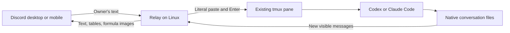

# Discord tmux Relay

Use a Discord channel to talk to Codex or Claude Code already running in a Linux tmux pane. Keep the terminal as the source of truth and use Discord as a mobile chat interface.

**One channel → one tmux pane → whichever supported agent is currently running there.**

The relay pastes your messages into the existing terminal and forwards new conversation messages from the agent's local transcript. It does not launch another model process or resume a second copy of your conversation.

> Personal-use reference implementation. It relies on native transcript formats, process metadata, and terminal titles that can change between agent versions. It is not an official Discord, OpenAI, or Anthropic integration.

## What it does

- Connect a channel to an existing tmux pane through a Discord picker.
- Follow supported session changes and process restarts in that pane.
- Keep new conversation messages in the same Discord channel.
- Separate assistant replies with numbered headings; split replies share a reply number and part counts such as `1/3`, including tables and formula images.
- Accept messages only from one configured Discord user in one configured server.
- Render Markdown tables as PNG images, splitting long tables with repeated headers and attaching the complete Markdown source.
- Render supported TeX formulas into PNG attachments locally with MathJax and Sharp.
- Run as a systemd user service without restarting the model processes.

It is a chat relay, not a terminal emulator. Approval dialogs, interactive menus, full-screen terminal applications, arbitrary shell prompts, and file uploads are not remotely controlled by this implementation.

## How it works



The binding belongs to the **pane**, not to a fixed process ID, working directory, or model session. The relay checks the current foreground process and its native session metadata before forwarding input. If it cannot identify a unique conversation, it pauses instead of selecting the newest transcript file.

## Installation

### 1. Prepare the Linux environment

Use the same Linux user account for the relay, tmux, and the model CLI. This version targets a normal host installation where they share the same process namespace and home directory.

Requirements:

- Node.js 24 or newer, with npm. See the [official Node.js downloads](https://nodejs.org/en/download).
- Python 3 with its standard `sqlite3` module.
- tmux, Git, and `flock` (provided by `util-linux` on Ubuntu).
- An installed and authenticated [Codex CLI](https://developers.openai.com/codex/cli/) or [Claude Code](https://code.claude.com/docs/en/overview).
- Outbound connectivity to Discord. No inbound HTTP endpoint is used.

On Ubuntu:

```bash
sudo apt update
sudo apt install -y git tmux python3 util-linux
node --version
npm --version
python3 -c 'import sqlite3'
```

Install Node.js separately if it is absent or older than the supported version. Do not assume your distribution's default Node package is recent enough.

### 2. Create a Discord application

1. Open the [Discord Developer Portal](https://discord.com/developers/applications) and create an application.
2. On its **Bot** page, create or retrieve the bot token. Keep it private.
3. Enable **Message Content Intent**. Ordinary channel messages require it; this implementation does not require Presence or Server Members intents. See [Discord's gateway documentation](https://discord.com/developers/docs/events/gateway#message-content-intent).
4. Configure a **Guild Install** with the `bot` and `applications.commands` scopes.
5. Grant the bot **View Channels**, **Send Messages**, **Read Message History**, **Add Reactions**, **Attach Files**, and **Embed Links** in the channels you intend to use. Administrator permission is unnecessary.
6. Use the installation link to add the bot to your Discord server.

The [official Discord getting-started guide](https://discord.com/developers/quick-start/getting-started) covers application creation and server installation. Portal labels may change over time.

Enable **Developer Mode** in your Discord client, then copy your **User ID** and **Server ID**. The user ID is the only account permitted to submit input through this relay.

Use a private channel if your agent conversation contains private project information. The input allowlist does not prevent other channel members from reading the bot's replies.

### 3. Install and configure the relay

```bash
git clone https://github.com/tie-pilot-qxw/discord-tmux-relay.git
cd discord-tmux-relay
npm ci
npm run init -- --owner YOUR_DISCORD_USER_ID --guild YOUR_DISCORD_SERVER_ID
```

Replace both ID placeholders with the copied numeric IDs. The initialization command refuses to overwrite an existing configuration.

By default, runtime data lives outside the checkout:

```text
~/.local/share/discord-tmux-relay/
├── config.json     # owner, server, and channel-to-pane bindings
├── discord-token   # bot credential
├── state.json      # transcript cursors and deduplication state
└── relay.lock      # service instance lock
```

Save the bot token using a hidden Bash prompt, rather than putting it into a command or shell history:

```bash
relay_data_dir="${RELAY_DATA_DIR:-$HOME/.local/share/discord-tmux-relay}"
mkdir -p "$relay_data_dir"
chmod 700 "$relay_data_dir"
(
  umask 077
  read -r -s -p 'Discord bot token: ' relay_bot_token
  printf '\n'
  printf '%s' "$relay_bot_token" > "$relay_data_dir/discord-token"
  unset relay_bot_token
)
chmod 600 "$relay_data_dir/discord-token"
```

`RELAY_DATA_DIR` may point to another **absolute** directory. Set it consistently for initialization, token storage, foreground startup, and service installation.

### 4. Start a model in tmux

Connect to your server using your normal terminal or SSH client. For a new pane:

```bash
tmux new -s project-chat
cd /path/to/project
codex
# Or run: claude
```

If you already have a running model in tmux, keep using that pane. There is no need to launch a replacement. Detach from tmux with `Ctrl+B`, then `D`; this leaves the process running.

### 5. Start the relay

For an initial foreground check:

```bash
npm start
```

Wait for the relay's ready message. If configuration is missing, the token is invalid, or Message Content Intent is not enabled, fix that before installing the service.

To run continuously, stop the foreground relay with `Ctrl+C`, then:

```bash
npm run install-service
systemctl --user daemon-reload
systemctl --user enable --now discord-tmux-relay.service
journalctl --user -u discord-tmux-relay.service -n 50 --no-pager
```

The generated unit records the current Node executable and checkout path. Run the installer again after moving the checkout or changing that Node installation. Run only one relay instance for this bot/configuration.

If your administrator allows user services to run after logout, enable lingering:

```bash
sudo loginctl enable-linger "$USER"
```

Lingering keeps the relay service available. It does **not** recreate tmux sessions or restart models after a machine reboot.

### 6. Connect a channel

Create a text channel and invoke **`/connect`**. Select the tmux pane that should receive its messages. The picker displays each pane's location and working directory.

Use the **Connect terminal** button whenever you need to reopen the picker. The public distribution uses English commands, buttons, and status messages.

Once connected, send ordinary text in that channel. No `@mention` is required. A ✅ reaction means the relay completed its paste-and-Enter operation; it does not mean the model has finished the task.

Use **`/status`** to inspect the binding. Use `/connect` again to select a different pane. A new channel stays inactive until you explicitly connect it.

## Daily use

| Action | What happens |
| --- | --- |
| Send a message from Discord | Discord takes priority: the relay clears the unsent terminal draft, verifies the composer, then pastes and submits your new text. |
| Type directly in the terminal | New visible conversation messages can also appear in Discord. |
| Switch native model sessions in the same pane | The relay follows once it can identify the selected session. |
| Exit a model, switch its login account, and restart it in the same pane | The relay waits for a supported foreground model, then reconnects. |
| Kill or recreate a tmux pane | Use `/connect` to select the new pane. |
| Restart the machine or tmux server | Recreate the desired terminal and reconnect through `/connect`. |
| Stop the relay | The models and their background work continue independently. |

For several projects, use several channels and panes. A single directory can have multiple panes and model conversations. Separate channels can therefore represent separate conversations within the same directory.

One pane can be connected to only one channel at a time in this implementation. To use a different pane, change the channel's connection through the picker.

### History and delivery semantics

Each native assistant message gets a visible reply heading. If formatting splits it into several Discord messages, every part carries the same reply number and its position. Reply numbers persist across relay restarts and connection changes within the channel. They identify individual native messages, not an entire multi-message agent turn. Existing Discord history is not reformatted retroactively.

- A new binding starts forwarding from the time it is connected. It does not import the entire old native conversation.
- Existing Discord messages remain when you switch the connection. That channel can therefore contain several native sessions over time.
- The relay follows new visible user/assistant messages, not every terminal screen update, reasoning event, tool call, or internal agent notification.
- The native transcript remains on the server and is the authoritative source for full model history.
- Delivery cursors and input hashes reduce duplicates during normal restarts. This is not a transactional exactly-once messaging system: a crash between sending a Discord message and saving its cursor can repeat output.
- Input blocked while the model is absent, unidentified, or in an unsupported UI state is not queued for automatic replay. Check the terminal before resending an input whose delivery is uncertain.

Discord input replaces unsent terminal drafts, including multiline drafts. The relay uses editing shortcuts and checks the result before submitting. It does not send Escape or Ctrl+C to clear input, interrupt a running task, or answer an approval dialog. Custom keymaps or an unrecognized composer may prevent clearing; in that case the new message is not submitted. This policy applies to Discord messages from both mobile and desktop clients. The relay does not preserve a copy of the overwritten draft.

### Tables and formulas

Pipe tables are rendered as PNG attachments so phone clients cannot reflow the columns. Tap an image to enlarge and pan. Long tables are paginated with repeated headers; exceptionally tall rows continue on the next page. Each table also includes its complete `.md` source for copying. Code examples are left unchanged. This is not an inline scrollable widget.

Install a font covering your content on the relay host (for Chinese on Ubuntu: `sudo apt install fonts-noto-cjk`). Rendering uses Noto Sans Mono CJK SC with a monospace fallback. Oversized tables or rendering failures retain the complete source attachment. TeX inside table cells is currently displayed as source text; formulas outside tables are rendered as described below.

TeX delimited by `\[ ... \]`, `$$ ... $$`, `\( ... \)`, or recognized `$ ... $` is rendered as PNG attachments. Tap the attachment to enlarge it on a phone. Inline formulas become separate image attachments rather than true inline typography. Code examples are left alone, and unsupported or oversized expressions fall back to readable TeX source. Not every TeX package is supported.

Rendering happens locally. Table and formula rendering make no model calls and send no content to third-party rendering services. The resulting image is uploaded to Discord as part of the requested reply.

## Troubleshooting

| Symptom | Check |
| --- | --- |
| The bot is online but ignores text | Check the configured owner/server IDs, Message Content Intent, channel access, and whether `/connect` has been completed. |
| `/connect` is missing | Verify the app was installed with `applications.commands` and that the relay completed startup. Commands are registered for the configured server. |
| No terminal appears | Run tmux under the same Linux user and default tmux socket as the relay. This version does not discover custom socket names. |
| The pane appears as waiting for a model | Start Codex or Claude Code in that pane, or return it to the foreground. |
| Input is blocked by a dialog or failed draft replacement | Ordinary drafts are overwritten automatically. Handle native approval dialogs separately; check custom editor keybindings if clearing cannot be verified. |
| Codex pauses while identifying a session | Use a unique native thread name and keep the default title fields containing the thread name. Update the adapter if the CLI's title or transcript format has changed. |
| A terminal restart does not reconnect | Check whether the pane or tmux server was recreated; select it again with `/connect`. |
| A formula is shown as source | Inspect its delimiters and TeX syntax, then run `npm test`. Unsupported commands or renderer limits trigger the fallback. |
| Old conversation history is absent | Expected for a new binding; the relay does not backfill entire sessions. |

```bash
systemctl --user status discord-tmux-relay.service
journalctl --user -u discord-tmux-relay.service -n 100 --no-pager
tmux list-panes -a -F '#{session_name}:#{window_index}.#{pane_index} #{pane_id} #{pane_current_command}'
```

Review logs locally before sharing them. Do not post your bot token, configuration, native transcripts, or process environments in an issue.

### Docker

Docker-hosted agents are not supported automatically. The relay needs access to the same tmux socket, process namespace, and native session files as the model. A host relay cannot reliably infer these through an arbitrary container boundary. This repository does not include a container adapter; validate an isolated deployment in the same environment before relying on it.

### Account changes and shell access

Log out and log in through the native model CLI, then restart that CLI in the connected pane as needed. The relay does not store or switch Codex/Claude credentials.

Channel text is sent to the model's input box, not executed directly by a shell. The model can still run commands according to its own permissions and approval settings. This relay does not add an operating-system sandbox or make an unsafe model configuration safe.

## Development and verification

```bash
npm ci
npm test
```

The tests exercise session-title selection and ambiguous matches, connection-picker guards, transcript cursors and deduplication, table pagination, and formula rendering. They use fixtures, do not contact Discord, and do not launch a model. Python 3 is required for the session adapter tests.

Important files:

| File | Responsibility |
| --- | --- |
| `bridge.mjs` | Discord events, channel queues, transcript polling, and output delivery |
| `connections.mjs` | Pane selection and persistent bindings |
| `terminal.mjs` | Foreground process checks and literal tmux input |
| `current-session.py` | Read-only native session identification |
| `follow.mjs` | Session transitions and transcript cursor adoption |
| `chat.mjs` | Visible conversation extraction and basic credential-pattern redaction |
| `format.mjs` | Table formatting and message splitting |
| `math.mjs`, `math-render.mjs` | Bounded local formula rendering and fallback |

The current Codex adapter reads `state_5.sqlite` and matches the pane title against session metadata. It handles known spinner/approval decorations and refuses ambiguous matches. The Claude adapter reads per-process session metadata and project JSONL files. These are implementation details of the native clients, not stable public APIs.

Basic redaction is best-effort and is not a data-loss-prevention system. Anything visible in a forwarded conversation should be considered shared with Discord and the members who can access that channel.

## Updating or stopping

```bash
git pull --ff-only
npm ci
npm test
systemctl --user restart discord-tmux-relay.service
```

To stop automatic forwarding:

```bash
systemctl --user disable --now discord-tmux-relay.service
```

Stopping or restarting this service does not stop the model or its tmux pane. Runtime state lives outside the repository; do not delete it during an ordinary update.
